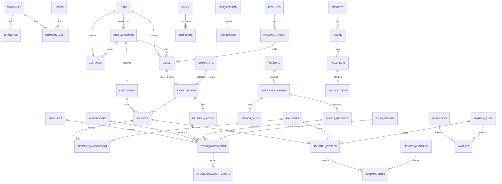

# Ledgerline ERP — Architecture & Database Schema

> Working name: **Ledgerline**. Modular ERP + CRM on Laravel (latest stable), PHP 8.3+, MySQL 8.

---

## 1. Build phases

| # | Phase | Modules | Key outcome |
|---|-------|---------|-------------|
| 1 | Foundation | Core, Auth, Settings, design system | Login with 2FA, company/branch scoping, roles, layout, Blade component library, numbering, custom fields, approvals, audit log |
| 2 | CRM | CRM | Leads → contacts/deals, Kanban pipeline, activities and calendar, tickets with SLA, campaigns, portal shell |
| 3 | Sales + Purchase | Sales, Purchase | Full document chains with PDFs, payments, credit/debit notes, recurring invoices, commissions |
| 4 | Inventory | Inventory | Warehouses and bins, stock ledger, FIFO and weighted-average costing, batches and serials, transfers, counts, reorder alerts |
| 5 | Accounting | Accounting | Chart of accounts, double-entry auto-posting from phases 3–4, bank reconciliation, financial statements |
| 6 | HR & Payroll | HR | Employees, attendance, leave with approvals, payroll and payslips, posting to GL, recruitment, reviews |
| 7 | Projects | Projects | Kanban, list and Gantt views, timesheets, billable hours → invoices |
| 8 | Manufacturing + POS | Manufacturing, POS | BOMs and work orders that consume and produce stock; POS checkout and session closing |
| 9 | Reports + API + Tests | Reports, all | Dashboard KPIs and charts, report exports, OpenAPI docs, end-to-end feature tests |

Every phase ships migrations, models, factories, seeders, services, Form Requests, policies, web and API routes, views and tests for its module.

---

## 2. Folder structure

```
ERP/
├── app/                          # Kernel-level only: base classes, shared infrastructure
│   ├── Support/
│   │   ├── Modules/              # ModuleManager, ModuleServiceProvider (base), module.json loader
│   │   ├── Tenancy/              # CurrentCompany, CompanyScope, BelongsToCompany trait
│   │   ├── Numbering/            # DocumentNumberGenerator (row-locked sequences)
│   │   ├── Money/                # Money value object, CurrencyConverter
│   │   └── Repositories/         # BaseRepository + interface
│   ├── Http/Middleware/          # SetCurrentCompany, EnsureModuleEnabled, SetLocale, SetTimezone
│   └── View/Components/          # Shared Blade component library (x-card, x-table, ...)
├── Modules/
│   ├── Core/                     # companies, branches, users, roles, settings, approvals, audit, search, import/export
│   ├── CRM/
│   ├── Sales/
│   ├── Purchase/
│   ├── Inventory/
│   ├── Accounting/
│   ├── HR/
│   ├── Projects/
│   ├── Manufacturing/
│   ├── POS/
│   └── Reports/
│       (every module has the same layout:)
│       ├── module.json           # name, version, dependencies, enabled-by-default, sidebar menu, permissions
│       ├── Providers/            # <Module>ServiceProvider, EventServiceProvider, RouteServiceProvider
│       ├── Config/
│       ├── Database/{Migrations,Seeders,Factories}/
│       ├── Models/
│       ├── Repositories/{Contracts,Eloquent}/
│       ├── Services/             # Business logic; the only layer that writes in transactions
│       ├── Actions/              # Single-purpose operations (ConvertLeadToDeal, PostInvoice, ...)
│       ├── Events/  Listeners/
│       ├── Http/{Controllers/{Web,Api},Requests,Resources}/
│       ├── Livewire/             # Interactive tables, Kanban, line-item editors
│       ├── Policies/
│       ├── Exports/  Imports/    # maatwebsite/excel
│       ├── Pdf/                  # dompdf view models
│       ├── Resources/{views,lang}/
│       ├── Routes/{web.php,api.php}
│       └── Tests/{Feature,Unit}/
├── resources/
│   ├── views/layouts/            # app (admin), guest (auth), portal (customer), print (PDF letterhead)
│   ├── views/components/         # x-card, x-table, x-button, x-badge, x-modal, x-slide-over, x-form.*
│   ├── css/app.css               # Tailwind + design tokens
│   └── js/app.js                 # Alpine, ApexCharts, Sortable (Kanban), Frappe Gantt
├── lang/{en,ar,...}/             # Global translations; RTL locales flagged in config/locales.php
├── docs/                         # ARCHITECTURE.md, API.md (+ generated OpenAPI), MODULES.md
└── tests/                        # Cross-module end-to-end flows (lead → ... → journal entry)
```

### Module system
- A lightweight in-house module loader in `app/Support/Modules`. Each module is a namespaced PSR-4 package (`Modules\CRM\...`) registered in `composer.json`. The `ModuleManager` reads every `module.json`, checks dependencies, and boots each module's service provider. That provider registers routes, migrations, views (`crm::leads.index`), translations, policies, Livewire components and the module's sidebar menu.
- **Per-company enable/disable:** the `company_modules` table, enforced by the `EnsureModuleEnabled:crm` middleware on routes and by menu filtering. Disabling a module hides it and blocks access. Its data stays in place.
- **Cross-module communication** uses only events, plus a few published contracts in `Modules/*/Contracts`. Example: Sales never queries Accounting tables directly. `InvoicePosted` is handled by `Accounting\Listeners\PostInvoiceToLedger`.

### Layers
`Controller (thin) → FormRequest (validation) → Policy (authorization) → Service/Action (business rules, DB::transaction) → Repository (queries) → Model (relations, scopes, casts)`
API controllers reuse the same services and return `JsonResource`s.

### Cross-cutting conventions
| Concern | Implementation |
|---|---|
| Tenancy | `BelongsToCompany` trait adds the `CompanyScope` global scope and auto-fills `company_id`. The current company comes from the session (web) or the `X-Company` header (API) and is validated against `company_user`. |
| Branch | Nullable `branch_id` on transactional records. A user's allowed branches are enforced by a `BranchScope` when restricted. |
| IDs | `id` BIGINT PK (internal joins) plus `uuid` CHAR(36) unique (routes, API, portal links). Route model binding uses `uuid`. |
| Numbering | `number_sequences` row locked with `SELECT ... FOR UPDATE` inside the transaction. Format tokens are `{PREFIX}-{YYYY}-{SEQ:4}`, e.g. `INV-2026-0001`. Sequences can reset yearly or monthly. |
| Money | Amounts `DECIMAL(18,4)`, quantities `DECIMAL(18,4)`, rates `DECIMAL(18,8)`. Each document stores `currency_code`, `exchange_rate` and base-currency totals. |
| Audit | spatie/activitylog on every business model (`LogsActivity`), with `created_by` and `updated_by` columns. |
| Soft deletes | On all master and document tables. Posted financial documents can't be deleted, only cancelled or reversed. |
| Custom fields | `custom_fields` definitions plus `custom_field_values` (polymorphic), rendered by `<x-custom-fields :model="$contact"/>`. |
| Approvals | `HasApprovals` trait. A document enters `pending_approval` when a workflow matches its type and conditions (e.g. PO total > 10,000). |
| Encryption | Encrypted casts on bank account numbers, tax IDs, employee national ID and salary bank details, and SMTP/SMS/gateway secrets. |
| i18n | `__()` everywhere, a per-user locale, `dir="rtl"` on the layout for RTL locales, Tailwind logical properties (`ms-`, `pe-`). |
| Time | Stored in UTC and displayed in the user's or company's timezone through a `UserTimezone` cast helper. |

### Key event map
| Event (emitter) | Listeners |
|---|---|
| `LeadConverted` (CRM) | Create contact and deal, log activity |
| `DealWon` (CRM) | Sales: ensure a customer exists for the deal's account or contact, then create a draft sales order from the deal products |
| `QuotationAccepted` (Sales) | Create a sales order |
| `DeliveryNoteValidated` (Sales) | Inventory: stock out. Accounting: COGS entry |
| `InvoicePosted` / `PaymentReceived` (Sales) | Accounting: AR entries. Sales: commission accrual. CRM: timeline |
| `GoodsReceived` (Purchase) | Inventory: stock in and valuation layers |
| `VendorBillPosted` / `VendorPaymentMade` | Accounting: AP entries |
| `StockAdjusted` (Inventory) | Accounting: inventory adjustment entry |
| `StockBelowReorderLevel` (Inventory) | Notify purchasing; optional draft requisition |
| `PayrollRunPosted` (HR) | Accounting: salary expense and payables |
| `LeaveRequestApproved` (HR) | Update leave balance, mark attendance |
| `TimesheetApproved` (Projects) | Mark billable hours ready to invoice |
| `WorkOrderCompleted` (Manufacturing) | Inventory: consume raw materials, produce finished goods |
| `PosSessionClosed` (POS) | Accounting: sales and cash entries; Inventory: stock out |

---

## 3. Database schema

**Standard columns** (abbreviated as `[std]` below):
`id BIGINT UNSIGNED PK AI, uuid CHAR(36) UNIQUE, company_id FK→companies (indexed), created_by FK→users NULL, updated_by FK→users NULL, created_at, updated_at, deleted_at NULL`

**Document header** (abbreviated as `[doc]`):
`[std] + branch_id FK NULL, number VARCHAR(30), date DATE, currency_code CHAR(3), exchange_rate DECIMAL(18,8), subtotal, discount_total, tax_total, total, base_total DECIMAL(18,4), status VARCHAR(20), notes TEXT, terms TEXT` · `UNIQUE(company_id, number)`, `INDEX(company_id, status, date)`

**Line item** (abbreviated as `[line]`):
`id, <parent>_id FK CASCADE, product_id FK NULL, description, quantity DECIMAL(18,4), unit_id FK NULL, unit_price, discount_percent DECIMAL(5,2), tax_id FK NULL, tax_amount, line_total DECIMAL(18,4), sort_order SMALLINT`

All tables use InnoDB and utf8mb4_unicode_ci. Every FK is indexed. Unless noted, FKs are `ON DELETE RESTRICT`; child lines use `CASCADE`.

### 3.1 Core
| Table | Columns (beyond std) | Indexes / notes |
|---|---|---|
| companies | id, uuid, name, legal_name, tax_number (enc), email, phone, address JSON, logo_path, base_currency_code, locale, timezone, fiscal_year_start_month TINYINT, date_format, is_active, timestamps, deleted_at | Tenant root (no company_id) |
| branches | [std], name, code, address JSON, phone, is_head_office | UNIQUE(company_id, code) |
| departments | [std], branch_id NULL, parent_id NULL, name, manager_id→users NULL | |
| users | id, uuid, name, email, password, phone, avatar_path, locale, timezone, current_company_id NULL, two_factor_secret, two_factor_recovery_codes, two_factor_confirmed_at, email_verified_at, is_active, last_login_at, remember_token, timestamps, deleted_at | UNIQUE(email) |
| company_user | company_id, user_id, branch_ids JSON NULL (null = all), is_owner, joined_at | PK(company_id, user_id) |
| roles / permissions / model_has_roles / model_has_permissions / role_has_permissions | spatie with **teams enabled** (team = company_id) | Roles are per company. Permission names follow `{module}.{entity}.{action}`, e.g. `sales.invoice.approve` |
| currencies | code CHAR(3) PK, name, symbol, decimals TINYINT | Global |
| company_currencies | company_id, currency_code, is_active | PK(company_id, currency_code) |
| exchange_rates | [std minus uuid], from_currency, to_currency, rate DECIMAL(18,8), effective_date | INDEX(company_id, from_currency, to_currency, effective_date) |
| taxes | [std], name, code, rate DECIMAL(7,4), type ENUM(percent,fixed), is_compound, is_inclusive, sales_account_id NULL, purchase_account_id NULL, is_active | Supports GST/VAT. Account FKs are added in phase 5 |
| tax_groups / tax_group_tax | [std], name / tax_group_id, tax_id, sequence | For combined taxes such as CGST+SGST |
| fiscal_years | [std], name, start_date, end_date, is_closed | UNIQUE(company_id, start_date) |
| number_sequences | id, company_id, document_type VARCHAR(40), prefix, format, next_number INT, padding TINYINT, reset_period ENUM(never,yearly,monthly), last_reset_at | UNIQUE(company_id, document_type) |
| settings | id, company_id NULL (null = global), group, key, value JSON, is_encrypted | UNIQUE(company_id, group, key). Covers SMTP, SMS, gateways and formats |
| company_modules | company_id, module VARCHAR(40), is_enabled, settings JSON | PK(company_id, module) |
| custom_fields | [std], entity_type VARCHAR(60), name, label, type ENUM(text,textarea,number,date,select,multiselect,checkbox,file), options JSON, is_required, sort_order | UNIQUE(company_id, entity_type, name) |
| custom_field_values | id, custom_field_id, model_type, model_id, value TEXT | UNIQUE(custom_field_id, model_type, model_id), INDEX(model_type, model_id) |
| approval_workflows | [std], document_type, name, conditions JSON, is_active | |
| approval_steps | id, approval_workflow_id, step_order, approver_type ENUM(user,role,manager), approver_id NULL, min_approvals TINYINT | |
| approval_requests | [std], approval_workflow_id, approvable_type, approvable_id, current_step, status ENUM(pending,approved,rejected,cancelled) | INDEX(approvable_type, approvable_id) |
| approval_actions | id, approval_request_id, approval_step_id, user_id, action ENUM(approved,rejected,commented), comment, acted_at | |
| attachments | [std], attachable_type, attachable_id, disk, path, original_name, mime, size | morph index |
| tags / taggables | [std], name, color / tag_id, taggable_type, taggable_id | |
| login_histories | id, user_id, ip_address, user_agent, successful, logged_in_at | INDEX(user_id, logged_in_at) |
| activity_log | spatie default + company_id column | INDEX(company_id, created_at) |
| notifications | Laravel default | |
| import_jobs / export_jobs | [std], module, entity, file_path, status, total_rows, processed_rows, failed_rows, errors JSON | Queued Excel jobs |
| jobs / failed_jobs / job_batches / cache / sessions | Laravel default | |

### 3.2 CRM
**Separate party tables (decision confirmed):** `crm_accounts` holds organizations in CRM and `contacts` holds people. `customers` (Sales, 3.3) and `vendors` (Purchase, 3.4) are separate master tables. A customer links back to its CRM account or contact through optional FKs. Converting a won deal or an account creates the customer record if one doesn't exist (`EnsureCustomerForAccount` action).

| Table | Columns | Indexes / notes |
|---|---|---|
| crm_accounts | [std], name, legal_name, email, phone, website, industry, employee_count, annual_revenue, tax_number (enc), billing_address JSON, shipping_address JSON, owner_id→users, parent_id NULL, source_lead_id NULL | INDEX(company_id, owner_id), FULLTEXT(name, email) |
| contacts | [std], crm_account_id NULL, first_name, last_name, job_title, email, phone, mobile, address JSON, owner_id→users, source_lead_id NULL, date_of_birth, do_not_email | INDEX(company_id, crm_account_id), FULLTEXT(first_name, last_name, email) |
| lead_sources | [std], name, is_active | |
| lead_statuses | [std], name, color, sort_order, is_converted, is_lost | |
| leads | [std], branch_id, title, first_name, last_name, company_name, email, phone, lead_source_id, lead_status_id, owner_id, score SMALLINT, estimated_value, currency_code, address JSON, description, converted_at, converted_contact_id NULL, converted_account_id NULL, converted_deal_id NULL, lost_reason | INDEX(company_id, lead_status_id), INDEX(company_id, owner_id) |
| lead_scoring_rules | [std], field, operator, value, points | Applied by `LeadScoringService` |
| pipelines | [std], name, is_default | |
| pipeline_stages | [std], pipeline_id, name, probability TINYINT, sort_order, is_won, is_lost, color | INDEX(pipeline_id, sort_order) |
| deals | [std], branch_id, pipeline_id, pipeline_stage_id, title, contact_id NULL, crm_account_id NULL, customer_id NULL, owner_id, value, currency_code, expected_close_date, probability, won_at, lost_at, lost_reason, sales_order_id NULL, kanban_order INT | INDEX(company_id, pipeline_id, pipeline_stage_id, kanban_order) |
| deal_products | [line] with deal_id | |
| activities | [std], type ENUM(call,meeting,task,note,email), subject, description, subject_type, subject_id (morph: lead, contact, crm_account, deal, ticket, customer), owner_id, due_at, starts_at, ends_at, location, outcome, priority, completed_at, reminder_at | INDEX(subject_type, subject_id), INDEX(company_id, owner_id, due_at) |
| activity_participants | activity_id, participant_type, participant_id | |
| email_templates | [std], name, module, subject, body (HTML with merge tags), is_active | |
| email_logs | [std], emailable_type, emailable_id, template_id NULL, from, to, cc, subject, body, status, sent_at, opened_at, error | morph index |
| segments | [std], name, rules JSON, is_dynamic | Dynamic segments are evaluated through a query builder |
| segment_contact | segment_id, contact_id | Static members |
| campaigns | [std], name, type ENUM(email,sms), segment_id, email_template_id NULL, status, scheduled_at, sent_at, budget, stats JSON | |
| campaign_recipients | id, campaign_id, contact_id, status, sent_at, opened_at, clicked_at, bounced_at | UNIQUE(campaign_id, contact_id) |
| sla_policies | [std], name, priority ENUM(low,medium,high,urgent), first_response_minutes, resolution_minutes, business_hours JSON | |
| ticket_categories | [std], name | |
| tickets | [std], number, customer_id NULL, contact_id NULL, subject, description, ticket_category_id, priority, status ENUM(open,pending,on_hold,resolved,closed), assigned_to, sla_policy_id, first_response_due_at, resolution_due_at, first_responded_at, resolved_at, channel ENUM(email,portal,phone,web) | INDEX(company_id, status, priority), INDEX(assigned_to) |
| ticket_replies | id, ticket_id, user_id NULL, contact_id NULL, body, is_internal, timestamps | |
| portal_users | id, uuid, customer_id, contact_id NULL, email, password, last_login_at, timestamps | Separate `portal` auth guard |

### 3.3 Sales
| Table | Columns | Notes |
|---|---|---|
| customers | [std], code, type ENUM(individual,business), name, email, phone, tax_number (enc), billing_address JSON, shipping_address JSON, currency_code, payment_terms_days, credit_limit, price_list_id NULL, sales_rep_id NULL, crm_account_id NULL, contact_id NULL, receivable_account_id NULL, is_active | UNIQUE(company_id, code), INDEX(company_id, crm_account_id), FULLTEXT(name, email) |
| price_lists | [std], name, currency_code, type ENUM(sales,purchase), is_default, valid_from, valid_to | |
| price_list_items | id, price_list_id, product_id, min_quantity, price, discount_percent | UNIQUE(price_list_id, product_id, min_quantity) |
| discount_rules | [std], name, type ENUM(percent,fixed), value, applies_to JSON, valid_from, valid_to | |
| quotations / quotation_items | [doc], customer_id→customers, deal_id NULL, valid_until, sales_rep_id, accepted_at · [line] | Statuses: draft, sent, accepted, rejected, expired |
| sales_orders / sales_order_items | [doc], customer_id, quotation_id NULL, deal_id NULL, warehouse_id, expected_delivery_date, sales_rep_id · [line] + delivered_qty, invoiced_qty | |
| delivery_notes / delivery_note_items | [doc], customer_id, sales_order_id, warehouse_id, shipping_address JSON, carrier, tracking_no, delivered_at · id, delivery_note_id, sales_order_item_id, product_id, quantity, unit_id, batch_id NULL, bin_location_id NULL | Validating creates stock movements |
| delivery_note_item_serials | delivery_note_item_id, serial_number_id | |
| invoices / invoice_items | [doc], customer_id, sales_order_id NULL, project_id NULL, due_date, amount_paid, balance_due, sales_rep_id, recurring_profile_id NULL, posted_at, journal_entry_id NULL · [line] + sales_order_item_id NULL, timesheet_id NULL, account_id NULL | Statuses: draft, posted, partially_paid, paid, overdue, cancelled. INDEX(company_id, customer_id, status, due_date) |
| payments | [std], branch_id, number, customer_id, date, amount, currency_code, exchange_rate, payment_method ENUM(cash,bank,card,cheque,online,other), bank_account_id, reference, gateway, gateway_txn_id, unallocated_amount, journal_entry_id | |
| payment_allocations | id, payment_id, invoice_id, amount | |
| credit_notes / credit_note_items | [doc], customer_id, invoice_id NULL, sales_return_id NULL, reason, amount_applied, journal_entry_id · [line] | |
| credit_note_applications | id, credit_note_id, invoice_id, amount, applied_at | |
| sales_returns / sales_return_items | [doc], customer_id, invoice_id, warehouse_id, reason · [line] + return_to_stock | Stock comes back in through Inventory |
| recurring_invoice_profiles | [std], customer_id, template_invoice_id, frequency ENUM(daily,weekly,monthly,quarterly,yearly), interval, start_date, end_date, next_run_date, auto_send, is_active | Run by the scheduler |
| payment_reminder_rules | [std], days_offset SMALLINT (negative = before due date), email_template_id, is_active | |
| commission_rules | [std], name, sales_rep_id NULL, basis ENUM(invoice_total,paid_amount,margin), rate, product_category_id NULL | |
| commissions | [std], sales_rep_id, invoice_id, commission_rule_id, amount, status ENUM(accrued,approved,paid), paid_at | |

### 3.4 Purchase
| Table | Columns | Notes |
|---|---|---|
| vendors | [std], code, name, contact_person, email, phone, website, tax_number (enc), address JSON, currency_code, payment_terms_days, bank_details (enc JSON), payable_account_id NULL, crm_account_id NULL, rating TINYINT, is_active | UNIQUE(company_id, code), FULLTEXT(name, email) |
| purchase_requisitions / _items | [doc], requested_by, department_id, required_by · [line] | Approval enabled |
| rfqs / rfq_items / rfq_vendors | [doc], requisition_id NULL, deadline · [line] · id, rfq_id, vendor_id, status, quoted_total, quoted_at, response JSON | Vendor quotes can be compared side by side |
| purchase_orders / _items | [doc], vendor_id→vendors, rfq_id NULL, warehouse_id, expected_date, payment_terms_days · [line] + received_qty, billed_qty | Approval enabled |
| goods_receipts / _items | [doc], vendor_id, purchase_order_id, warehouse_id, received_at · id, goods_receipt_id, purchase_order_item_id, product_id, quantity, unit_cost, bin_location_id, batch_no, expiry_date, serials JSON | Creates stock movements and valuation layers |
| vendor_bills / _items | [doc], vendor_id, purchase_order_id NULL, vendor_reference, due_date, amount_paid, balance_due, posted_at, journal_entry_id · [line] + account_id NULL | |
| vendor_payments / vendor_payment_allocations | Mirrors payments and allocations, with vendor_id and vendor_bill_id | |
| debit_notes / _items | [doc], vendor_id, vendor_bill_id NULL, reason, journal_entry_id · [line] | |

### 3.5 Inventory
| Table | Columns | Notes |
|---|---|---|
| product_categories | [std], parent_id, name, slug, income_account_id, expense_account_id, inventory_account_id | Nested categories |
| brands | [std], name | |
| units | [std], name, short_name, base_unit_id NULL, conversion_factor DECIMAL(18,6) | e.g. Box = 12 × Piece |
| products | [std], parent_id NULL (variant parent), type ENUM(stockable,consumable,service,kit), name, sku, barcode, product_category_id, brand_id, unit_id, purchase_unit_id, description, sale_price, purchase_price, cost_price, tax_id, purchase_tax_id, costing_method ENUM(fifo,average), track_inventory, tracking ENUM(none,batch,serial), has_expiry, reorder_level, reorder_quantity, weight, dimensions JSON, image_path, is_sellable, is_purchasable, is_active | UNIQUE(company_id, sku), INDEX(company_id, barcode), FULLTEXT(name, sku) |
| product_attributes / product_attribute_values | [std], name · id, attribute_id, value | |
| product_variant_values | product_id, attribute_value_id | PK(product_id, attribute_value_id) |
| warehouses | [std], branch_id, name, code, address JSON, is_default, allow_negative_stock | UNIQUE(company_id, code) |
| bin_locations | [std], warehouse_id, code, description | UNIQUE(warehouse_id, code) |
| batches | [std], product_id, batch_no, manufactured_at, expiry_date | UNIQUE(company_id, product_id, batch_no), INDEX(expiry_date) |
| serial_numbers | [std], product_id, serial_no, batch_id NULL, warehouse_id NULL, status ENUM(in_stock,sold,returned,scrapped) | UNIQUE(company_id, product_id, serial_no) |
| stock_levels | id, company_id, product_id, warehouse_id, bin_location_id NULL, batch_id NULL, quantity, reserved_quantity, avg_cost, updated_at | UNIQUE(product_id, warehouse_id, bin_location_id, batch_id). Denormalized balance, always updated under row lock |
| stock_movements | id, uuid, company_id, product_id, warehouse_id, bin_location_id, batch_id, serial_number_id, quantity (+ in / − out), unit_cost, total_cost, balance_after, type ENUM(receipt,delivery,transfer_in,transfer_out,adjustment,production_in,production_out,return_in,return_out,pos,opening), reference_type, reference_id, moved_at, created_by | Immutable ledger. INDEX(company_id, product_id, moved_at), INDEX(reference_type, reference_id) |
| stock_valuation_layers | id, company_id, product_id, warehouse_id, stock_movement_id, quantity, remaining_quantity, unit_cost, created_at | FIFO layers. INDEX(product_id, warehouse_id, remaining_quantity) |
| stock_transfers / _items | [doc minus money], from_warehouse_id, to_warehouse_id, status ENUM(draft,in_transit,completed,cancelled) · product_id, quantity, batch_id, from_bin_id, to_bin_id | |
| stock_adjustments / _items | [doc minus money], warehouse_id, reason, journal_entry_id · product_id, batch_id, bin_location_id, quantity_change, unit_cost | |
| stock_counts / _items | [doc minus money], warehouse_id, status ENUM(draft,counting,reviewed,applied) · product_id, batch_id, bin_location_id, system_qty, counted_qty, variance | Applying a count generates an adjustment |
| stock_reservations | id, company_id, product_id, warehouse_id, quantity, reservable_type, reservable_id | Sales order reservations |

### 3.6 Accounting
| Table | Columns | Notes |
|---|---|---|
| ledger_accounts | [std], parent_id, code, name, type ENUM(asset,liability,equity,income,expense), sub_type (e.g. bank, receivable, payable, inventory, cogs, tax), currency_code NULL, is_group, is_system, is_active, opening_balance | UNIQUE(company_id, code). Chart of accounts tree |
| account_mappings | id, company_id, key VARCHAR(60) (e.g. `sales.receivable`, `inventory.cogs`), ledger_account_id | UNIQUE(company_id, key). Lets auto-posting use configurable accounts |
| journal_entries | [std], branch_id, number, date, fiscal_year_id, reference, narration, source_type, source_id (morph to invoice, bill, payslip, and so on), currency_code, exchange_rate, total_debit, total_credit, status ENUM(draft,posted,reversed), posted_at, reversed_entry_id NULL | INDEX(company_id, date), INDEX(source_type, source_id). A DB-level check plus the service enforce debit = credit |
| journal_lines | id, journal_entry_id CASCADE, ledger_account_id, partner_type NULL, partner_id NULL (morph: customer, vendor, employee), description, debit, credit, base_debit, base_credit, cost_center_id NULL, project_id NULL | INDEX(ledger_account_id, journal_entry_id), INDEX(partner_type, partner_id) |
| cost_centers | [std], name, code, parent_id | |
| bank_accounts | [std], ledger_account_id, name, bank_name, account_number (enc), iban (enc), swift, currency_code, opening_balance, is_active | |
| bank_transactions | [std], bank_account_id, date, description, reference, amount (+/−), balance, is_reconciled, reconciliation_id NULL, matched_journal_line_id NULL, import_batch | INDEX(bank_account_id, date, is_reconciled) |
| bank_reconciliations | [std], bank_account_id, statement_date, statement_balance, reconciled_balance, status | |
| expense_categories | [std], name, ledger_account_id | |
| expenses | [doc], expense_category_id, vendor_id NULL, paid_from_bank_account_id, payment_method, receipt_path, is_billable, project_id NULL, journal_entry_id | Approval enabled |
| budgets / budget_lines | [std], name, fiscal_year_id, cost_center_id NULL, status · id, budget_id, ledger_account_id, period TINYINT (1–12), amount | UNIQUE(budget_id, ledger_account_id, period) |

Reports (Trial Balance, P&L, Balance Sheet, Cash Flow by the indirect method, GL, Aged AR/AP, Tax) are computed from `journal_lines`, `invoices` and `vendor_bills` with indexed aggregate queries and cached per filter hash. No report tables are needed.

### 3.7 HR & Payroll
| Table | Columns | Notes |
|---|---|---|
| designations | [std], name, department_id NULL | |
| employees | [std], user_id NULL, branch_id, department_id, designation_id, manager_id→employees, employee_code, first_name, last_name, email, phone, date_of_birth, gender, marital_status, national_id (enc), address JSON, emergency_contact JSON, hire_date, probation_end_date, termination_date, employment_type ENUM(full_time,part_time,contract,intern), status ENUM(active,on_leave,terminated), bank_details (enc JSON), photo_path | UNIQUE(company_id, employee_code) |
| employee_documents | [std], employee_id, type, title, path, expires_at | Expiry alerts |
| employment_contracts | [std], employee_id, type, start_date, end_date, salary_structure_id, base_salary, terms, file_path, status | |
| shifts | [std], name, start_time, end_time, break_minutes, grace_minutes, working_days JSON | |
| employee_shifts | id, employee_id, shift_id, effective_from, effective_to | |
| holidays | [std], name, date, is_recurring | |
| attendances | [std], employee_id, date, shift_id, check_in_at, check_out_at, worked_minutes, overtime_minutes, late_minutes, status ENUM(present,absent,half_day,leave,holiday,weekend), source ENUM(manual,web,biometric,import) | UNIQUE(employee_id, date) |
| leave_types | [std], name, days_per_year, is_paid, carry_forward_max, requires_approval, color | |
| leave_balances | id, company_id, employee_id, leave_type_id, fiscal_year_id, allocated, used, carried_forward | UNIQUE(employee_id, leave_type_id, fiscal_year_id) |
| leave_requests | [std], employee_id, leave_type_id, start_date, end_date, days DECIMAL(5,2), is_half_day, reason, status ENUM(pending,approved,rejected,cancelled) | Approval enabled |
| salary_components | [std], name, code, type ENUM(earning,deduction), calculation ENUM(fixed,percent_of_basic,formula), value, formula, is_taxable, ledger_account_id | |
| salary_structures / salary_structure_components | [std], name · structure_id, component_id, value_override | |
| employee_salaries | [std], employee_id, salary_structure_id, base_salary, effective_from | |
| payroll_runs | [std], number, period_start, period_end, pay_date, status ENUM(draft,processed,approved,posted,paid), total_gross, total_deductions, total_net, journal_entry_id | Approval enabled |
| payslips | [std], payroll_run_id, employee_id, number, working_days, paid_days, gross, total_deductions, net, status, emailed_at | UNIQUE(payroll_run_id, employee_id) |
| payslip_lines | id, payslip_id, salary_component_id, name, type, amount | |
| job_openings | [std], title, department_id, designation_id, location, employment_type, description, vacancies, status, closes_at | |
| applicants | [std], job_opening_id, name, email, phone, resume_path, stage ENUM(applied,screening,interview,offer,hired,rejected), rating, notes | |
| interviews | [std], applicant_id, scheduled_at, interviewer_id, feedback, rating | |
| review_cycles / performance_reviews / review_scores | [std], name, period_start, period_end · cycle_id, employee_id, reviewer_id, overall_rating, comments, status · review_id, criterion, score, comment | |

### 3.8 Projects
| Table | Columns | Notes |
|---|---|---|
| projects | [std], code, name, customer_id NULL→customers, manager_id, start_date, end_date, status, billing_type ENUM(fixed,hourly,non_billable), budget_amount, hourly_rate, currency_code, description | |
| project_members | project_id, user_id, role, hourly_rate | |
| milestones | [std], project_id, name, due_date, amount, is_completed, invoice_id NULL | |
| task_statuses | [std], name, color, sort_order, is_done | Kanban columns |
| tasks | [std], project_id, milestone_id, parent_id, title, description, task_status_id, priority, start_date, due_date, estimated_hours, progress TINYINT, kanban_order, is_billable | INDEX(project_id, task_status_id, kanban_order) |
| task_assignees | task_id, user_id | |
| task_dependencies | task_id, depends_on_task_id, type ENUM(fs,ss,ff,sf) | Gantt links |
| timesheets | [std], user_id, project_id, task_id, date, minutes, description, is_billable, hourly_rate, status ENUM(draft,submitted,approved,invoiced), invoice_item_id NULL | INDEX(project_id, status), INDEX(user_id, date) |

### 3.9 Manufacturing
| Table | Columns | Notes |
|---|---|---|
| boms / bom_items | [std], product_id, code, quantity, is_default, version · id, bom_id, component_product_id, quantity, unit_id, scrap_percent | |
| bom_operations | id, bom_id, name, workstation, duration_minutes, cost_per_hour, sequence | |
| production_plans / production_plan_items | [doc minus money], period_start, period_end · product_id, planned_qty, sales_order_id NULL | |
| work_orders | [std], number, product_id, bom_id, production_plan_id NULL, warehouse_id, quantity, produced_quantity, scheduled_start, scheduled_end, started_at, completed_at, status ENUM(draft,confirmed,in_progress,completed,cancelled) | |
| work_order_materials | id, work_order_id, product_id, required_qty, consumed_qty, batch_id NULL | |

### 3.10 POS
| Table | Columns | Notes |
|---|---|---|
| pos_registers | [std], branch_id, warehouse_id, name, receipt_header, receipt_footer, default_customer_id | |
| pos_sessions | [std], pos_register_id, user_id, opened_at, closed_at, opening_cash, expected_cash, counted_cash, difference, status, journal_entry_id | |
| pos_orders / pos_order_items | [doc], pos_session_id, customer_id, change_given · [line] + batch_id, serial_number_id | |
| pos_payments | id, pos_order_id, method, amount, reference | Supports split payments |

### 3.11 Reports
| Table | Columns | Notes |
|---|---|---|
| saved_reports | [std], user_id, report_key, name, filters JSON, is_shared | Saved filter presets |
| scheduled_reports | [std], saved_report_id, frequency, recipients JSON, format ENUM(pdf,xlsx,csv), next_run_at | |

---

## 4. Core ER diagram (key relationships)



---

## 5. Auto-posting rules (Accounting)

| Source | Debit | Credit |
|---|---|---|
| Invoice posted | Accounts Receivable (total) | Sales income (per line/category), Output tax (per tax) |
| Customer payment | Bank/Cash | Accounts Receivable |
| Credit note | Sales returns, Output tax | Accounts Receivable |
| Delivery (stock out) | COGS | Inventory (FIFO or average cost) |
| Goods receipt | Inventory | Goods Received Not Invoiced (GRNI) |
| Vendor bill | GRNI / Expense, Input tax | Accounts Payable |
| Vendor payment | Accounts Payable | Bank/Cash |
| Stock adjustment (+/−) | Inventory / Inventory loss | Inventory gain / Inventory |
| Expense | Expense account, Input tax | Bank/Cash |
| Payroll run | Salary expense (per component) | Salaries payable, deduction liabilities |
| Payroll payment | Salaries payable | Bank |
| POS session close | Cash/Card clearing | Sales income, Output tax (+ COGS / Inventory) |
| Work order complete | Finished goods inventory | Raw material inventory |

Every posting runs inside `DB::transaction`. Each one is idempotent: the unique key is `(source_type, source_id)` among non-reversed entries. Corrections reverse the entry; posted entries are never edited.

---

## 6. Admin panel design system

- **Tokens** (`tailwind.config.js`): `navy-900 #1E2A44` sidebar, `ivory #F8F7F4` background, `gold-500 #B8975A` accent, slate text scale, success `#2F7D5B`, warning `#B7791F`, danger `#B23A3A`. Dark mode (`class` strategy) uses a navy-950 background and slate-800 cards.
- **Type:** Libre Baskerville for headings (h1–h3, page titles, document letterheads); Inter for body text and data with tabular numbers.
- **Shape:** radius 6px for inputs and buttons, 8px for cards; 1px `slate-200` borders; shadow `0 1px 2px rgb(30 42 68 / .06), 0 1px 3px rgb(30 42 68 / .08)`; 4px spacing scale.
- **Components:** `x-layout.app`, `x-sidebar`, `x-header`, `x-breadcrumbs`, `x-card`, `x-stat-card`, `x-button`, `x-badge`, `x-modal`, `x-slide-over`, `x-dropdown`, `x-tabs`, `x-toast`, `x-empty-state`, `x-table` (+ Livewire `DataTable` base with sorting, filters, column toggle, bulk actions, sticky header and pagination), `x-form.input|select|searchable-select|date|textarea|checkbox|file|money`, `x-line-items` (Livewire line editor), `x-custom-fields`, `x-chart` (ApexCharts wrapper).
- **Accessibility:** WCAG AA contrast (gold is used for accents and borders, never body text on ivory), visible `focus-visible` rings, a skip link, ARIA on modals and menus, full keyboard navigation for the Kanban (move with arrow keys plus Space).

---

## 7. API

- `/api/v1/{module}/{resource}` with standard REST routes. Sanctum tokens have abilities that mirror permission names. `X-Company` header selects the company.
- Resources use `uuid` as `id`. Lists support `?filter[status]=posted&sort=-date&include=items&per_page=50`.
- Action endpoints include `POST /api/v1/sales/invoices/{uuid}/post`, `/payments`, `/pdf`, and `POST /api/v1/crm/leads/{uuid}/convert`.
- Rate limit: 120 requests per minute per token. Errors use an RFC 7807-style JSON body.
- Documentation: `docs/API.md` plus a generated OpenAPI spec (Scribe).

---

## 8. Testing strategy
- **Unit:** numbering, money and currency conversion, tax calculation (inclusive, exclusive, compound), FIFO and average costing, journal balancing, payroll calculation, SLA due dates, lead scoring.
- **Feature (per module):** CRUD plus policy denial, company isolation (company A can never see company B's data), API auth and abilities.
- **End to end:** lead → convert → deal won → sales order → delivery (stock out + COGS) → invoice (AR entry) → payment (bank entry), with trial-balance totals asserted to balance at every step.
- Tests run on MySQL (not SQLite) so FULLTEXT, locking and JSON behavior match production. CI runs `pest --parallel`.
